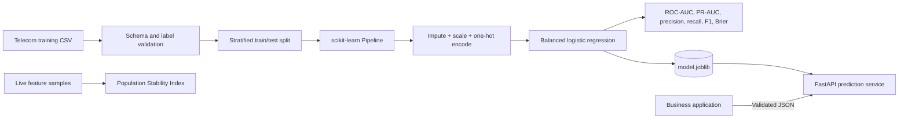

# IntelliChurn

**A reproducible machine-learning platform for training, serving, and monitoring telecom customer-churn predictions.**

[](https://github.com/haarikaalla/ML-Intelli-Churn/actions/workflows/ci.yml)


IntelliChurn converts a notebook-style churn experiment into an end-to-end ML system. A single scikit-learn pipeline owns preprocessing and classification, the training workflow reports decision-relevant metrics, a typed FastAPI service exposes predictions, and a population stability index utility provides a foundation for drift monitoring.

The project is designed to prevent common ML delivery failures: training-serving skew, hidden preprocessing, invalid input, misleading accuracy on imbalanced data, unreproducible artifacts, and silent feature-distribution changes.

## Business impact

Customer churn models are useful only when their predictions can drive timely retention actions. IntelliChurn estimates each customer's churn probability from contract, tenure, billing, service, and support features. That score can support:

- prioritizing high-risk customers for retention outreach;
- tailoring offers by contract and service profile;
- measuring the precision/recall trade-off before campaign launch;
- monitoring whether live customer behavior has drifted from training data;
- versioning the model behind a stable application contract.

The output is a probability and decision label, not an unexplained business guarantee. Teams can adjust the operating threshold according to intervention cost and retention value.

## Platform capabilities

| Capability | Implementation | Value |
| --- | --- | --- |
| Schema validation | Required feature and target checks | Fails early on incompatible training data |
| Unified preprocessing | `ColumnTransformer` inside one pipeline | Prevents training-serving transformation drift |
| Missing-value handling | Median and most-frequent imputers | Makes preprocessing explicit and repeatable |
| Mixed feature support | Scaling + one-hot encoding | Handles numeric and categorical telecom data |
| Imbalance-aware model | Class-balanced logistic regression | Gives minority churn cases appropriate weight |
| Decision metrics | ROC-AUC, PR-AUC, precision, recall, F1, Brier score | Evaluates ranking, actions, and calibration |
| Typed inference | Pydantic request and response contracts | Rejects malformed production input |
| Drift signal | Population Stability Index | Detects numeric distribution shifts |
| Reproducible delivery | Package, Docker, tests, and CI | Makes the system reviewable and deployable |

## End-to-end architecture



### Training-to-serving consistency

The serialized artifact contains both feature transformations and the classifier. The API loads that exact pipeline and submits a typed feature row to `predict_proba`. No preprocessing is manually duplicated in the serving layer.

## Technology stack

### Machine learning

- **pandas 2.2+** — tabular ingestion and validation
- **NumPy 2.1+** — numerical operations and drift calculations
- **scikit-learn 1.6+** — preprocessing, logistic regression, stratified evaluation, and metrics
- **joblib** — pipeline artifact serialization

### API and engineering

- **FastAPI** — versioned inference and health endpoints
- **Pydantic v2** — strict request constraints and response schema
- **Uvicorn** — ASGI serving
- **Hatchling** — Python packaging
- **pytest** — deterministic training and monitoring tests
- **Ruff** — linting and quality enforcement
- **Docker** — reproducible inference image
- **GitHub Actions** — automated tests and linting

## Model workflow

1. Validate that every required feature and the `Churn` label exist.
2. Convert `TotalCharges` to numeric form and normalize `Yes`/`No` labels.
3. Reject missing or single-class targets before training.
4. Create a reproducible, stratified 80/20 split.
5. Median-impute and standardize numeric features.
6. Most-frequent-impute and one-hot encode categorical features.
7. Train class-balanced logistic regression with a fixed random seed.
8. Evaluate ranking, classification, and probability calibration.
9. Save the complete pipeline and metrics as versionable artifacts.

## Evaluation strategy

Plain accuracy can look strong while missing most churners. IntelliChurn reports:

| Metric | Why it matters |
| --- | --- |
| ROC-AUC | Overall ranking separation across thresholds |
| PR-AUC | Performance on the positive churn class under imbalance |
| Precision | How many targeted customers actually churn |
| Recall | How many churners the campaign identifies |
| F1 | Balance between precision and recall |
| Brier score | Quality and calibration of predicted probabilities |
| Positive rate | Context for interpreting imbalanced metrics |

No fixed score is advertised because results depend on the supplied dataset and split. Every training run writes its own measured `metrics.json`.

## Quick start

### Prerequisites

- Python 3.11+
- Git
- A compatible telecom churn CSV

### Install

```bash
git clone https://github.com/haarikaalla/ML-Intelli-Churn.git
cd ML-Intelli-Churn

python -m venv .venv
source .venv/bin/activate            # Windows: .venv\Scripts\activate
python -m pip install --upgrade pip
pip install -e '.[dev]'
```

### Train and evaluate

```bash
intelli-churn-train path/to/telco-churn.csv --output artifacts
```

This creates:

```text
artifacts/
├── model.joblib    # fitted preprocessing + classifier pipeline
└── metrics.json    # evaluation results from the held-out test split
```

Generated model artifacts and raw datasets are intentionally excluded from Git. This keeps source control small and avoids publishing data that may have licensing or privacy restrictions.

### Serve predictions

```bash
MODEL_PATH=artifacts/model.joblib \
MODEL_VERSION=1.0.0 \
uvicorn intelli_churn.api:app --reload
```

Open `http://127.0.0.1:8000/docs` for the generated OpenAPI console.

## API reference

| Method | Endpoint | Purpose |
| --- | --- | --- |
| `GET` | `/health` | Confirms the model is available and reports its version |
| `POST` | `/v1/predict` | Returns churn probability, label, and model version |

Example request:

```bash
curl -X POST http://127.0.0.1:8000/v1/predict \
  -H 'Content-Type: application/json' \
  -d '{
    "gender": "Female",
    "SeniorCitizen": 0,
    "Partner": "Yes",
    "Dependents": "No",
    "tenure": 8,
    "PhoneService": "Yes",
    "MultipleLines": "No",
    "InternetService": "Fiber optic",
    "OnlineSecurity": "No",
    "OnlineBackup": "No",
    "DeviceProtection": "No",
    "TechSupport": "No",
    "StreamingTV": "Yes",
    "StreamingMovies": "Yes",
    "Contract": "Month-to-month",
    "PaperlessBilling": "Yes",
    "PaymentMethod": "Electronic check",
    "MonthlyCharges": 94.5,
    "TotalCharges": 756.0
  }'
```

Response shape:

```json
{
  "churn_probability": 0.734281,
  "prediction": "churn",
  "model_version": "1.0.0"
}
```

The shown probability is illustrative; the deployed model determines the actual value.

## Configuration

| Variable | Default | Description |
| --- | --- | --- |
| `MODEL_PATH` | `artifacts/model.joblib` | Serialized pipeline loaded by the API |
| `MODEL_VERSION` | `1.0.0` | Version returned with predictions and health data |

If the artifact is unavailable, the health and prediction endpoints return `503` rather than pretending the service is ready.

## Drift monitoring

The included `population_stability_index(reference, current)` utility compares a numeric production sample with its training reference distribution using quantile bins and numerical safeguards.

```python
from intelli_churn.monitoring import population_stability_index

psi = population_stability_index(reference_tenure, current_tenure)
print({"feature": "tenure", "psi": psi})
```

PSI is a drift indicator, not proof that model quality has degraded. A production monitor should combine feature drift, prediction drift, delayed labels, business outcomes, and alert thresholds validated for the domain.

## Docker

Train the model into `artifacts/` before building because the image packages the inference artifact:

```bash
intelli-churn-train path/to/telco-churn.csv --output artifacts
docker build -t intelli-churn .
docker run --rm -p 8000:8000 \
  -e MODEL_VERSION=1.0.0 \
  intelli-churn
```

## Quality and testing

```bash
ruff check src/intelli_churn tests
pytest
```

The tests use deterministic synthetic data, so CI requires no private dataset. They verify model training and decision metrics, schema failure behavior, and the ability of PSI to distinguish stable from shifted distributions.

## Project structure

```text
.
├── .github/workflows/ci.yml       # lint and test automation
├── src/intelli_churn/
│   ├── api.py                     # inference and health API
│   ├── contracts.py               # typed request/response schemas
│   ├── features.py                # feature lists and data validation
│   ├── monitoring.py              # PSI drift utility
│   ├── predictor.py               # artifact loading and inference
│   └── training.py                # reproducible training pipeline
├── tests/test_training.py         # synthetic end-to-end tests
├── Dockerfile                     # inference container
├── pyproject.toml                 # dependencies and package metadata
└── LICENSE
```

## Responsible-use notes

- Predictions should support human decision-making, not automatically penalize customers.
- Teams should test performance across relevant customer groups and investigate unequal error rates.
- Feature collection, retention, and activation must follow applicable privacy and consumer-protection requirements.
- Retraining should require data validation, evaluation gates, artifact lineage, and rollback capability.

## Production roadmap

- model registry, artifact checksums, and lineage metadata;
- time-based and out-of-time validation;
- configurable decision thresholds and cost-based evaluation;
- batch scoring and scheduled drift jobs;
- authentication, rate limiting, structured logs, and tracing;
- shadow deployment, approval gates, and automated rollback;
- outcome monitoring and fairness evaluation;
- a retention-operations dashboard for prioritized interventions.

## License

This project is available under the [MIT License](LICENSE).
