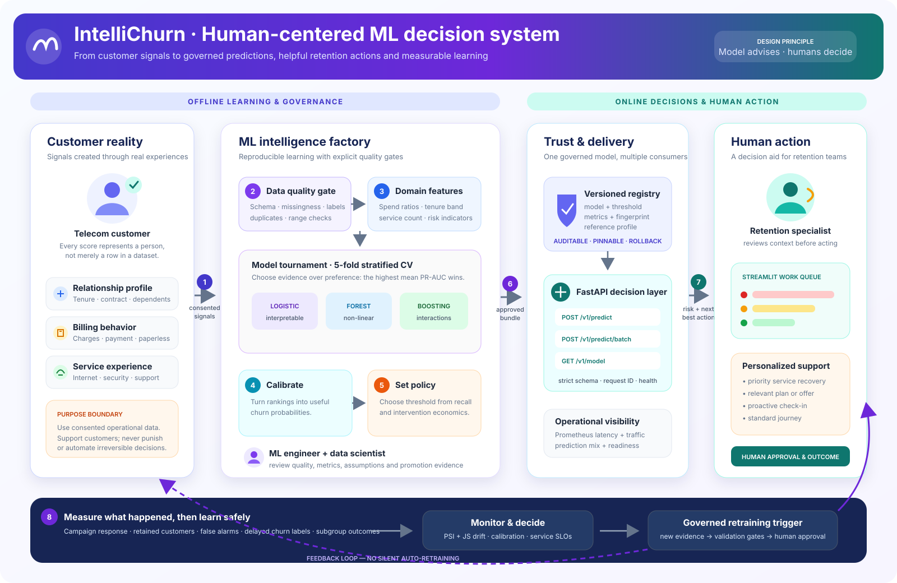

# IntelliChurn

### Production-minded customer-retention intelligence, from validated data to monitored decisions

[](https://github.com/haarikaalla/ML-Intelli-Churn/actions/workflows/ci.yml)


IntelliChurn is an end-to-end machine-learning system that ranks telecom customers by churn risk and turns calibrated probabilities into an actionable retention queue. It covers the entire lifecycle: data contracts, quality profiling, domain feature engineering, model comparison, probability calibration, business-cost thresholding, immutable model versions, online and batch inference, drift monitoring, operational metrics, a Streamlit console, tests, CI and containerized delivery.

This is deliberately more than a notebook or prediction page. The same serialized pipeline performs feature engineering at training and serving time, every model carries its lineage and operating threshold, and the API exposes readiness, model-card and Prometheus endpoints suitable for real deployment.

## Verified benchmark

The project's original 7,043-row Telco churn dataset was evaluated with a fixed random seed, a 64%/16%/20% stratified train/validation/test design, five-fold model selection on the training split, threshold selection on validation only, and one final evaluation on the untouched test split. The raw CSV is intentionally excluded from the final repository; its SHA-256 lineage prefix and measured report are retained without republishing third-party data. That retained report records the original three-model run; every new training run now compares **five** architectures, including the shallow neural network and deep MLP described below.

| Held-out result | Value |
| --- | ---: |
| ROC-AUC | **0.8478** |
| PR-AUC | **0.6675** |
| Recall | **98.66%** |
| Precision | **35.01%** |
| Brier score | **0.1343** |
| Test customers | **1,409** |
| Selected model | **Calibrated logistic regression** |

The cost-aware threshold produced an estimated **90.21% reduction in decision cost** relative to taking no retention action, under the explicit example assumptions of 500 units per missed churner, 15 per contacted customer, and a minimum 45% recall constraint. This is a scenario estimate—not realized revenue or a production guarantee. Change the costs to match an actual business before using the result for decisions. Full reproducible results are stored in [`reports/reference_benchmark.json`](reports/reference_benchmark.json).

## Binary classification architecture lab

One command now evaluates classical machine learning and neural networks under the same leakage-safe contract:

| Candidate | Architecture | Role in the comparison |
| --- | --- | --- |
| Logistic regression | scaled features → sigmoid probability | interpretable linear baseline |
| Random forest | 240 balanced trees → probability average | bagged non-linear baseline |
| Histogram gradient boosting | sequential histogram trees → logistic loss | strong tabular learner |
| Shallow neural network | input → dense 24 ReLU → sigmoid | compact non-linear neural baseline |
| Multilayer perceptron | input → 64 ReLU → 32 ReLU → 16 ReLU → sigmoid | higher-capacity deep comparison |

Both neural candidates use balanced sample weights, L2 regularization, deterministic initialization and validation-based early stopping. Neural models are not assumed to win: mean stratified cross-validation PR-AUC promotes the best minority-class ranker, regardless of family. The selected pipeline is then calibrated before validation-only threshold optimization and one final untouched-test evaluation.

The Streamlit **Architecture comparison** tab makes this experiment visible: it presents all five model cards, CV PR-AUC, CV ROC-AUC, fold variability, mean fit time, the selected winner and simple diagrams for both neural designs.

A deterministic 900-customer smoke benchmark verifies the complete five-model path in [`reports/neural_demo_benchmark.json`](reports/neural_demo_benchmark.json). On that synthetic sample, the deep MLP reached **0.3124 CV PR-AUC** and the shallow network reached **0.3121**, close to the random forest at **0.3130**; logistic regression remained the honest winner at **0.3477**. These are implementation-verification results, not production-performance claims.

## What problem it solves

A useful churn system must answer more than “will this customer leave?” IntelliChurn answers:

- Who should the retention team contact first?
- How reliable is each probability?
- Which threshold minimizes the cost of missed churn and unnecessary outreach?
- Which model won under cross-validation, and why?
- Which dataset and configuration created the deployed artifact?
- Has production input drifted away from training conditions?
- Is the service alive, ready, observable and safe to call in batches?

Each prediction returns a probability, decision, risk band, recommended action, threshold and model version. That makes the output operational and auditable instead of a detached class label.

## Architecture

<p align="center">
  
</p>

The architecture is organized around people and decisions—not just infrastructure:

1. **Customer reality:** consented relationship, billing and service signals describe the customer's experience.
2. **Quality before modeling:** the pipeline rejects incompatible schemas, bad labels, duplicates and invalid values before learning.
3. **Shared business features:** one transformer creates service-count, spend-ratio, tenure and contract indicators for both training and inference.
4. **Evidence-based selection:** five classical and neural architectures compete under stratified cross-validation; mean PR-AUC selects the candidate.
5. **Probability and policy are separate:** calibration improves the risk estimate, while validation-only cost optimization chooses when the business should act.
6. **Governed promotion:** the approved bundle stores the complete pipeline, threshold, metrics, dataset fingerprint and drift baseline under an immutable version.
7. **One decision layer, multiple workflows:** FastAPI supports real-time applications, bulk scoring, model inspection and operational telemetry; Streamlit gives specialists a prioritized work queue.
8. **Human action and learning:** a retention specialist reviews context, chooses an appropriate intervention and records outcomes. Drift, calibration, service health and delayed labels inform a governed retraining decision—there is no silent automatic retraining.

The solid path represents the live decision flow. The purple feedback path represents monitored learning from real outcomes back into the next reviewed training cycle.

### Training-serving contract

`CustomerFeatureEngineer`, preprocessing and the estimator live inside the model pipeline. The versioned `ModelBundle` also carries the decision threshold, dataset SHA-256 fingerprint, training timestamp, configuration, candidate scores, held-out metrics, feature importance and drift reference profile. The service never recreates training transformations by hand.

## Capabilities

| Area | Implementation | Engineering value |
| --- | --- | --- |
| Data quality | Required fields, numeric coercion, invalid labels, negative-value guard, duplicate IDs, missingness profile | Fails early and reports the condition of each training run |
| Domain features | spend/tenure ratios, service count, tenure band, contract and fiber indicators | Encodes customer-lifecycle behavior consistently |
| Model selection | Logistic regression, random forest, gradient boosting, shallow neural network and deep MLP | Compares five binary classifiers by stratified mean PR-AUC |
| Calibration | `CalibratedClassifierCV` with sigmoid calibration | Makes risk scores more useful for prioritization |
| Decision policy | Validation-only threshold search with configurable FP/FN/action costs | Separates model quality from business action policy |
| Evaluation | ROC-AUC, PR-AUC, precision, recall, F1, Brier, confusion matrix and cost scenario | Covers ranking, minority detection, calibration and impact |
| Explainability | Held-out permutation importance | Reports model-agnostic global drivers |
| Registry | Immutable version folders plus atomic `latest` pointer | Supports lineage, pinning and rollback |
| Serving | Strict Pydantic contracts, single and 500-row batch APIs | Rejects malformed data before inference |
| Batch operations | CSV-to-CSV retention queue CLI | Supports scheduled business workflows |
| Drift | PSI for numeric features and Jensen-Shannon divergence for categoricals | Detects input distribution changes across all features |
| Observability | Request IDs, latency/request/prediction Prometheus metrics, liveness/readiness | Supports production operations |
| Delivery | Package entry points, non-root multi-stage Docker image, Compose, tests and GitHub Actions | Creates a reproducible review and deployment path |

## Quick start

### 1. Install

```bash
git clone https://github.com/haarikaalla/ML-Intelli-Churn.git
cd ML-Intelli-Churn

python -m venv .venv
source .venv/bin/activate            # Windows: .venv\Scripts\activate
python -m pip install --upgrade pip
pip install -e '.[dev,dashboard]'
```

Python 3.11 or newer is required.

### 2. Train and register a model

```bash
intelli-churn-train path/to/telco-churn.csv
```

The command validates the dataset, compares candidates, calibrates the winner, selects the business threshold, evaluates the untouched test set and creates:

```text
artifacts/registry/
├── latest.json
└── <timestamp>-<data-hash>/
    ├── model.joblib
    ├── metadata.json
    └── training_report.json
```

No dataset available? Generate a contract-compatible demo:

```bash
intelli-churn-demo-data --rows 2500
intelli-churn-train data/demo_telco_churn.csv
```

### 3. Start the API

```bash
uvicorn intelli_churn.api:app --reload
```

- OpenAPI: <http://127.0.0.1:8000/docs>
- readiness: <http://127.0.0.1:8000/health/ready>
- model card: <http://127.0.0.1:8000/v1/model>
- Prometheus: <http://127.0.0.1:8000/metrics>

### 4. Open the operations console

```bash
streamlit run dashboard/app.py
```

Use the performance tab to inspect the held-out model card, the architecture tab to compare all binary classifiers, and the queue tab to score a compatible CSV, inspect the prioritized high-risk segment and download the full result.

## Prediction API

| Method | Endpoint | Purpose |
| --- | --- | --- |
| `GET` | `/health/live` | Process liveness; does not require a model |
| `GET` | `/health/ready` | Confirms the selected model can be loaded |
| `GET` | `/v1/model` | Model version, evaluation, lineage and top features |
| `POST` | `/v1/predict` | One validated churn decision |
| `POST` | `/v1/predict/batch` | Up to 500 validated decisions per request |
| `POST` | `/v1/monitor/drift` | All-feature drift report for 10–10,000 rows |
| `GET` | `/metrics` | Prometheus-format service and prediction metrics |

Example:

```bash
curl -X POST http://127.0.0.1:8000/v1/predict \
  -H 'Content-Type: application/json' \
  -d '{
    "gender":"Female", "SeniorCitizen":0, "Partner":"No", "Dependents":"No",
    "tenure":8, "PhoneService":"Yes", "MultipleLines":"No",
    "InternetService":"Fiber optic", "OnlineSecurity":"No", "OnlineBackup":"No",
    "DeviceProtection":"No", "TechSupport":"No", "StreamingTV":"Yes",
    "StreamingMovies":"Yes", "Contract":"Month-to-month",
    "PaperlessBilling":"Yes", "PaymentMethod":"Electronic check",
    "MonthlyCharges":94.5, "TotalCharges":756.0
  }'
```

Response:

```json
{
  "churn_probability": 0.712438,
  "prediction": "churn",
  "risk_band": "high",
  "recommended_action": "Route to the retention team for a priority personalized offer.",
  "decision_threshold": 0.05,
  "model_version": "20261020.055013-16320c9c"
}
```

The probability above demonstrates the response contract; live output comes from the loaded model.

## Batch scoring and drift

```bash
# Produce an enriched retention queue
intelli-churn-score customers.csv --output outputs/retention_queue.csv

# Compare current traffic with the registered training baseline
intelli-churn-monitor customers.csv --output outputs/drift_report.json
```

Numeric PSI status is stable below 0.10, warning from 0.10 and alert from 0.25. Categorical Jensen-Shannon status is stable below 0.05, warning from 0.05 and alert from 0.10. These defaults are operational starting points; production thresholds should be tuned using observed model and business outcomes.

## Configuration

| Setting | Default | Purpose |
| --- | --- | --- |
| `MODEL_REGISTRY` | `artifacts/registry` | Filesystem registry used by the API |
| `MODEL_VERSION` | `latest` | Immutable version to load, or latest pointer |
| `MODEL_PATH` | unset | Direct artifact override, useful in managed deployments |
| `API_URL` | `http://localhost:8000` | API used by the Streamlit console |
| `--cv-folds` | `5` | Stratified model-selection folds |
| `--min-recall` | `0.45` | Threshold-search recall floor |

Cost assumptions and randomization are centralized in `TrainingConfig`, making model behavior reproducible and reviewable.

## Docker deployment

Train once on the host, then run the API and dashboard with the artifact mounted read-only:

```bash
intelli-churn-train path/to/telco-churn.csv
docker compose up --build
```

The API runs at port 8000 and the dashboard at port 8501. The API image is multi-stage, uses a dedicated non-root user and includes a liveness health check.

## Testing and CI

```bash
ruff check src/intelli_churn tests dashboard
pytest --cov=intelli_churn --cov-report=term-missing
docker build --target runtime -t intelli-churn:test .
```

Tests use deterministic synthetic telecom data and cover both neural architectures, schema failure, five-model selection, full training, model registry round trips, prediction contracts, drift detection and API health. GitHub Actions validates Python 3.11 and 3.12, publishes coverage output and verifies the container build.

## Repository map

```text
.
├── dashboard/app.py                 # retention operations console
├── reports/reference_benchmark.json # original 7,043-row dataset benchmark
├── reports/neural_demo_benchmark.json # reproducible five-model smoke benchmark
├── src/intelli_churn/
│   ├── api.py                       # typed API and observability
│   ├── artifacts.py                 # versioned model registry
│   ├── batch.py                     # offline scoring workflow
│   ├── contracts.py                 # strict request/response models
│   ├── data_quality.py              # dataset quality report
│   ├── demo_data.py                 # deterministic demo generator
│   ├── feature_engineering.py       # domain transformations
│   ├── features.py                  # feature/data contracts
│   ├── modeling.py                  # candidates and preprocessing
│   ├── monitoring.py                # PSI and categorical drift
│   ├── predictor.py                 # inference boundary
│   └── training.py                  # selection, calibration and evaluation
├── tests/                           # unit and integration tests
├── Dockerfile                       # non-root multi-stage image
├── docker-compose.yml               # API + console stack
└── pyproject.toml                   # package and dependency contract
```

## Responsible ML and limitations

- Churn scores assist a retention team; they should not trigger punitive or irreversible decisions.
- The example dataset is small and cross-sectional. A real deployment needs temporal/out-of-time evaluation and retraining triggers.
- Global permutation importance is not a causal explanation and does not prove why an individual customer will churn.
- Cost estimates depend entirely on the configured assumptions and must be replaced with validated business economics.
- Teams should evaluate subgroup error rates, consent, data minimization, retention policy and applicable consumer-protection rules before launch.
- Drift signals show distribution change, not performance loss. Join them with delayed labels, calibration checks and campaign outcomes.

## License

Released under the [MIT License](LICENSE).
